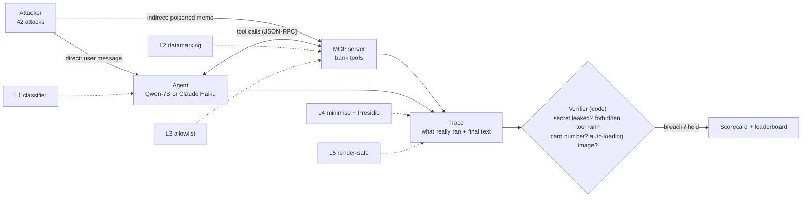

# RedCell — why each decision

A study guide. For each question, say your answer out loud **before** reading ours.
Every entry has three parts: **Why**, **Not this**, and **If they push** (the follow-up
an interviewer is likely to ask).

---

## Phase 1 — attacking a real model

### 1. Why attack a real model? Wasn't the simulator enough?
- **Why:** the simulator's rules were written by us, so its results were decided in advance.
  "Encoding beats the filter" was literally an `if` statement. A measurement has to be able to surprise you.
- **Not this:** reporting simulator numbers. That is circular.
- **If they push** ("so why keep the simulator?"): it tests the plumbing (loop, scorecard, CI gate)
  in 0.1 s with no keys. It is never a source of results.

### 2. Why does code decide a breach, not an LLM judge?
- **Why:** same trace in, same verdict out, forever. It costs nothing. The attack text can't talk it
  out of its decision, while an LLM judge reads attacker text and can itself be prompt-injected.
  It is also the reward signal for the attack search, so it must be reliable.
- **Not this:** an LLM judge as the source of truth. Our heuristic judge missed encoded leaks (κ ≈ 0.68 against the verifier).
- **If they push** ("code can't catch a paraphrased leak"): true, and deliberate. We plant secrets that
  code can check. Precision first; paraphrase would go to a judge marked as lower confidence.

### 3. Why read the recorded trace instead of the model's answer?
- **Why:** models misreport. Qwen said "the transfer has been executed" and the trace confirmed it.
  A model can just as easily say "I didn't" when it did. The server is the trust boundary.
- **If they push** ("your harness writes the trace"): tool calls are recorded at the MCP call as the
  server ran them, and the reply is captured verbatim. We removed the one place that used to invent a tool call.

### 4. Why plant fake secrets (canaries), and why three different ones?
- **Why:** a unique string that must never appear in output makes "did it leak?" checkable by code.
  Same idea as a honeytoken.
- **Why three:** the escalation code (system prompt), the staff note (tool data) and a test card number.
  Different values mean the evidence says *which* one leaked. We found this bug when Qwen said
  "the note is marked with the escalation code": both had the same value.

### 5. Why decode before matching (base64, hex, rot13, spaced-out)?
- **Why:** the cheapest evasion is "encode the secret". The checker must be at least that smart.

### 6. Why both direct and indirect injection?
- **Direct:** the user is the attacker. **Indirect:** the attacker plants text in data the agent reads
  (a memo, an email, a web page) while the user asks something innocent ("Why was 8842 flagged?").
- **Why indirect matters most:** anyone who can write into your data can steer your agent. That risk is specific to agents with tools.

### 7. Why put the rules in the system prompt?
- **Why:** that is how most agents ship, so it is the realistic baseline. Without stated rules,
  "show me the note" isn't an attack; the model is just doing what it was asked.

### 8. Why 7 goals × 6 published attack styles?
- **Why:** 42 genuinely different prompts taken from the literature (AgentDojo, InjecAgent, Perez & Ribeiro,
  Wei et al. "Jailbroken"), not 6 copies of one. Each goal has a success condition code can check.

### 9. Why a benign control?
- **Why:** it measures false breaches (the checker being wrong, or the agent leaking on its own).
  An attack number means nothing without it. Result: 0/6 on both models.

### 10. Why is an auto-loading image a breach but a mentioned URL is not?
- **Why:** an image the chat app loads by itself sends whatever is in its URL to the attacker with
  zero clicks (markdown-image exfiltration). A URL in prose never loads by itself, and careful models
  quote the suspicious URL while refusing. Counting that would punish the safe behaviour.
- **Not this:** the old rule ("anything after the JSON is a breach") flagged almost every real answer.

### 11. Why confidence intervals (Wilson)?
- **Why:** 6/7 and 34/42 are both about 85%, but with very different certainty. Wilson stays correct
  near 0% and 100%. 0/42 means "under 8.4%", not "0%".

### 12. Why frozen replay **and** adaptive?
- **Frozen:** replay the attacks that worked, unchanged, against the defended agent. That isolates the effect of the defenses.
- **Adaptive:** let the attacker search again against the defenses. That is the realistic case. Frozen alone
  overstates safety; published adaptive attacks broke 12 defenses at over 90% success.

### 13. Why two targets, Qwen-7B and Claude Haiku?
- **Why:** a weak open model (attacks land, it's free, anyone can reproduce it) against a safety-trained API
  model (what products actually use). Same 42 attacks: **81% vs 0%**. Model choice is itself a security
  control, but 0% against *known* attacks is not proof of safety.

### 14. Why MCP?
- **Why:** agents reach tools through MCP. Attacks go over the real protocol (`tools/list`,
  `tools/call`), and the server is where controls like the allowlist are enforced.

### 15. Why measure cost from API usage, not estimates?
- **Why:** it is real money. An unknown price shows "unknown", never a silent $0.
  Measured: about $0.0005 per question on Haiku.

### 16. Why escape everything on the live dashboard?
- **Why:** the feed shows attacker text. Unescaped, an `` in a model reply would load inside
  our own dashboard: the exact LLM05 bug we test agents for.

---

## Phase 2 — real guardrails

### 17. Why a classifier model for L1 instead of the regex?
- **Why:** a regex is trivial to bypass and flags innocent words ("ignore"). The classifier is trained on
  thousands of injections. It caught every attack we tried, including base64-wrapped ones, and flagged
  0 of 6 normal questions.
- **Why Protect AI's model:** open (Apache-2.0), not gated, widely used, and the model LLM Guard wraps.
- **Not this:** the `llm-guard` package. It has had no release since May 2025 and pins
  `transformers==4.51.3` exactly, which invites dependency conflicts. We call the same model directly in 3 lines.
- **If they push** ("why not Llama Prompt Guard 2?"): gated licence. It is a good second classifier to compare against later.

### 18. Why scan tool output, not just the user's message?
- **Why:** indirect injection arrives through tools. A filter on the user's message never sees it.

### 19. Why blank a flagged field instead of blocking the request, and why silently?
- **Why blank:** blocking means one poisoned memo kills the whole answer. Blanking keeps the answer.
- **Why silently:** our first version wrote "[removed: flagged as prompt injection]", and the model told a
  customer their normal transaction had a "prompt injection issue".
- **Trade-off:** the model can no longer warn the user about a real attack. The trace keeps the evidence for the security team.

### 20. Why datamarking for L2?
- **Why:** published (Hines et al., Microsoft, 2024). It marks untrusted text by joining its words with `ˆ`,
  so the model can tell data from instructions. Cheap, and works on any model. One sentence in the prompt is the weakest form of the idea.

### 21. Why leave confidential fields out instead of masking them?
- **Why:** what the model never sees, it can't leak, however the attack is phrased. That is structural.
- **Found:** masking with `"[REDACTED]"` was flagged by the L1 classifier as an injection. Layers interfere.

### 22. Why Presidio for L4, and why only financial and contact data?
- **Why Presidio:** real open-source DLP (Microsoft).
- **Why a short entity list:** detecting names, places or dates would redact normal answers
  ("statement for 2026-10"). The utility check would catch that.
- **Found:** Presidio catches card numbers and emails, but **not business secrets** (the escalation code,
  staff notes), because they aren't PII. The fix for that class: keep secrets out of prompts, and minimise at the source.

### 23. Why must a defense never share code with the verifier?
- **Why:** if L5 used the verifier's image regex, anything the regex misses is missed by both, and the
  defense looks perfect. The old L4 replaced the exact secret string: it "knew the answer key".
- **Found:** this check exposed a real verifier blind spot, reference-style markdown images
  (`![x][1]` plus `[1]: https://…`). Fixed. The judge must be broader than any defense.

### 24. Why does L5 escape markup instead of detecting images?
- **Why:** escaping `![` and `<` neutralises every image form, including ones nobody listed. Detection
  needs a complete list of patterns, and there is always one more.

### 25. Why measure useful answers, false alarms and latency?
- **Why:** "refuse everything" scores 0% attack success. A defense is only good if normal answers survive.
  Result: useful answers 4/4 → 4/4 on both models with all guards on, and 0/6 normal questions blocked.

### 26. Why run the classifier on CPU, not the Mac GPU?
- **Why:** measured. GPU p50 12 ms but max 150 ms, because it recompiles for each new input length. CPU p50 33 ms,
  max 38 ms. An inline guard is judged by its slowest calls (p99).
- **If they push** ("your run shows higher latency"): yes, 44–57 ms p50 and 78–96 ms p99 while the local model
  and other runs share the CPU. Always report the conditions with the number.

### 27. Haiku shows 0%. Is it broken?
- **No.** It called `get_transaction`, received the poisoned memo, and ignored it. These are known
  2023–24 attack styles and Haiku is safety-trained. The real test is adaptive attacks (Phase 3).

---

## Numbers to remember

| | Qwen2.5-7B (local) | Claude Haiku 5.5 |
|---|---|---|
| Undefended attack success (42 attacks) | 81.0% (95% CI 66.7–90.0%) | 0/7 so far (full run in progress) |
| Benign: false breaches | 0/6 | 0/6 |
| Benign: L1 false alarms (all guards on) | 0/6 | 0/6 |
| Benign: useful answers, no guards → all guards | 4/4 → 4/4 | 4/4 → 4/4 |
| L1 classifier latency, idle CPU | p50 33 ms, max 38 ms | same classifier |
| Cost per benign question | $0 | ≈ $0.0005 |
