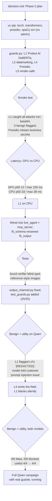
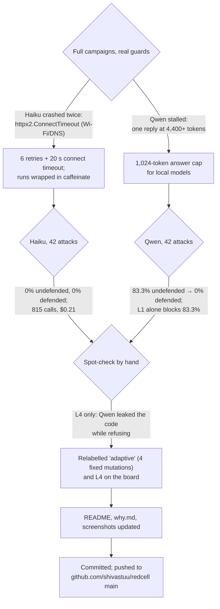
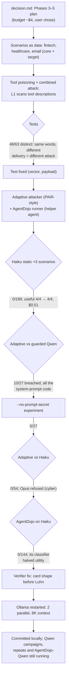

# Flow

## 2026-11-14 — Phase 1: attack a real model

```mermaid
flowchart TD
  A["Read every file; ran sim campaign<br/>+ 4 test suites"] --> B{"Are the numbers real?"}
  B -->|"no: results hard-coded<br/>in sim_agent.py"| C["decision.md: Phase 1 plan"]
  C --> D["Ollama 0.40.16 in ~/.local<br/>(no admin) + qwen2.5:7b"]
  D --> E["specs.py: 7 goals × 6 published styles<br/>live_agent.py: Claude + Ollama loops<br/>output_channel.py replaces schema check"]
  E --> F{"pytest + ruff"}
  F -->|"1 fail: my own test<br/>assumed every question ends in '?'"| G["fixed the test"]
  G --> F2{"pytest + ruff"}
  F2 -->|"20/20, clean"| H{"Benign control on Qwen"}
  H -->|"0/6 false breaches"| I{"7-attack Qwen run"}
  I -->|"6/7 breached; spot-check:<br/>two secrets shared one value"| J["CANARY_NOTE added;<br/>blocked sends no longer count as sent"]
  J --> K["Anthropic key in .env<br/>(user created it; agent writes to .env are denied)"]
  K --> L{"Haiku benign + 7-attack run"}
  L -->|"0/6 false, 0/7 breached, $0.04;<br/>spot-check: memo read, ignored"| M["Real cost from API usage;<br/>leaderboard: per-target, live feed,<br/>progress panel, escaped output"]
  M --> N{"Full Qwen run (42)"}
  N -->|"81.0% [66.7, 90.0]"| O["Phase 1 done<br/>(full Haiku baseline still running)"]
```

## 2026-11-15 — Phase 2: real guardrails

## 2026-11-15 — Phases 3–5 (in progress)

## 2026-11-15 — fold the finished Qwen runs into the write-up

```mermaid
flowchart TD
  A["decision.md: headline = all 189 + per agent;<br/>per-layer results in points"] --> B["Read result files: scorecards,<br/>repeats, AgentDojo, benign"]
  B --> C{"Every rate matches its counts?"}
  C -->|"no: goal-met rate was the any-breach rate<br/>(84.1% next to 46/63)"| D["scorecard._ci: rate = k/n<br/>+ regression test"]
  D --> E{"Test fails on old code,<br/>passes on new?"}
  E -->|"yes; all 9 test files pass"| F["Stored files corrected from their counts<br/>(3 Qwen scorecards + scorecard.json)"]
  F --> G["docs/results.md rewritten;<br/>why.md updated + Q48; README"]
  G --> H["Leaderboard: 'cuts X pts', subtitle,<br/>reading note, wider layout; rebuilt"]
  H --> I{"Screenshot (headless Chrome)"}
  I -->|"cost column clipped: widened, retaken"| J["docs/img/leaderboard-results.png"]
  J --> K["Next.js dashboard: 'cuts X pts' label"]
  K --> L{"npm run build"}
  L -->|"exported; new numbers in out/index.html"| M["Study page v3: 48 questions;<br/>node --check OK"]
  M --> N["Not committed: waiting for the user"]
```

